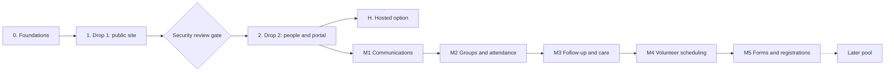

# LibreEkklesia delivery plan

**Status:** draft for owner review, 25 November 2026.
**Dates:** none. The owner chose not to track target dates, so phases are ordered by gates, not by calendar.

This plan follows `scope-decisions.md` and `stack-decisions.md`. Where it disagrees with them, they win. Source of truth: the `docs/` folder of https://github.com/asanderson/LibreEkklesia.

## How to read this plan

- Phases run in order unless marked as a parallel track. Each phase has an entry gate, the catalog rows it ships, its tasks, checkpoints and exit criteria.
- Task IDs such as `D1-07` belong to this plan. Row IDs such as `WEB-05` refer to `feature-catalog.md`.
- Tasks are vertical slices, sized S (one or two files), M (one feature slice, three to five files) or L. Any L task is split before work starts.
- Detail falls off with distance. Phase 0 through drop 2 have full task lists. Modules after the MVP get their tasks at the start of their phase, as the depth rule requires.
- At the start of each phase, each task becomes a GitHub issue. If the agent build workflow is used, the phase's tasks also go into `tasks/plan.md` and `tasks/todo.md`.

## Phase map

| Phase | Goal | Starts when | Done when |
|---|---|---|---|
| 0. Foundations | Repository, skeleton stack, CI, release pipeline, spikes | Now | Skeleton runs end to end, every scan is green, a signed test image is published, rollback is proven |
| 1. Drop 1: public site | Eastside's public site runs on LibreEkklesia, with no member data | Phase 0 checkpoint passed | 30 rows shipped, pilot site live, Google Sites retired |
| Gate: security review | Prove the kernel before member data enters | Drop 1 live | All five gate items done, findings fixed or accepted in writing |
| 2. Drop 2: people and portal | People, households, opt-in directory, member portal | Gate passed | 26 rows shipped, pilot members using the portal, MVP complete |
| H. Hosted option (parallel) | Host other churches, invite-only | Drop 2 live at the pilot | First hosted church live under every guardrail |
| M1 to M5. Modules | Communications, groups and attendance, follow-up and care, volunteer scheduling, forms and registrations | MVP complete, in this order | Each module shipped behind its toggle and used at the pilot |
| Later pool | Unscheduled modules | An owner decision at phase start | Not scheduled |
| Maintenance | Updates, upgrades, audits | Phase 0 | Continuous |

## Roles

- **Owner:** decides, reviews and merges. Handles owner-only actions: accounts, domains, legal, the pilot relationship.
- **Spec agent:** turns a phase's rows into specs and tasks for owner sign-off.
- **Builder agents (backend, frontend):** one task per branch and pull request.
- **Test agent:** owns unit, API, end-to-end and accessibility suites.
- **Security-reviewer agent:** never a builder. Reviews every change to sign-in, sessions, permissions, people data, backups and the updater, and runs the gate audit.
- **Accessibility reviewer:** manual keyboard and screen-reader passes on new interfaces.
- **Docs agent:** operator guide, admin guide and decision-log entries.

## Definition of done (every task)

1. Acceptance criteria met and covered by tests: unit and API tests, plus end-to-end tests for user-visible flows.
2. All checks green: ruff, strict type checking, pytest, Vitest, ESLint, vue-tsc, Playwright with axe (WCAG 2.2 AA) on touched pages, pip-audit, npm audit, CodeQL and the ZAP baseline.
3. The eight security rules still hold. Changes to sign-in, sessions, permissions, people data, backups or updates carry the security-reviewer agent's approval.
4. No new dependency without a written reason. Versions pinned with hashes, and the release-age delay respected.
5. Nothing loads from third parties. The content security policy holds.
6. New data is covered by the full-instance export and, if sensitive, by the audit trail. The data-flows page lists any new outside service.
7. Admin and operator docs updated. Any change to a decision is logged, dated, in its decision document.
8. Reviewed by an agent other than its builder, and merged by the owner.

## Phase 0: Foundations

**Goal:** a working skeleton of the decided stack, with every gate automated before feature work starts.
**Starts:** now.

- **P0-01 Repository basics** · S · docs agent
  README with summary, status and links to the docs. `SECURITY.md` that routes reports through GitHub's private vulnerability reporting, so no personal email is published (also covers gate item 5, `INC-04`). Pull request template carrying the definition of done.
  *Done when:* GitHub shows the security policy and a test pull request shows the template.
- **P0-02 GitHub settings** · S · owner
  Turn on private vulnerability reporting, secret protection with push protection, Dependabot alerts and code scanning. Protect `main` with a ruleset: pull request required, required status checks, no force pushes. Install the Claude GitHub App on this repository so cloud agent sessions can push branches and open pull requests.
  *Done when:* a direct push to `main` is refused and an agent session can push a branch.
- **P0-03 Name follow-ups** · XS · owner
  Register libreekklesia.com and libreekklesia.org. Optionally reserve the `libreekklesia` GitHub organization name so nobody else takes it. Book the trademark attorney screen, which must finish before drop 1 goes public.
  *Done when:* both domains are registered and the screen is booked.
- **P0-04 Agent workspace rules** · S · spec agent
  `AGENTS.md`, with a `CLAUDE.md` pointer: docs are the source of truth, the dependency policy, the security rules, the definition of done, one task per pull request, and the roles above.
  *Done when:* a fresh agent session follows the rules on a trial task.
- **P0-05 Spike: lockfiles and package manager** · S · builder
  Pick the Python lockfile tool and frontend package manager that pin with hashes and can hold back releases younger than about 7 days. Record the choice and reason in `stack-decisions.md`.
  *Done when:* lockfiles exist and a test shows a too-new release is refused.
- **P0-06 Backend skeleton** · M · builder · after P0-05
  Django 6.1 with Django Ninja and its OpenAPI description. django-allauth in headless mode installed but not yet wired. Built-in admin off in production settings, content security policy on, SQLite on the data volume, Django Tasks with django-tasks-db.
  *Done when:* pytest passes, the OpenAPI description is served, the CSP header is present and the admin route is absent in production settings.
- **P0-07 Spike: OpenAPI client generator** · S · builder · after P0-06
  Choose the generator under the dependency rules and generate a typed client from the skeleton API.
  *Done when:* the generated client compiles under vue-tsc.
- **P0-08 Frontend skeleton** · M · builder · after P0-07
  Vue 3, Vite, TypeScript and vue-tsc, Vue Router, vue-i18n and the generated client. Built files are vendored, with no package registry contacted at install or runtime.
  *Done when:* the app shell builds the same way twice, loads, and passes axe.
- **P0-09 Bundle skeleton** · M · builder · after P0-06 and P0-08
  Docker Compose with Caddy (HTTPS, serves the generated site and built app, forwards only API calls), Django under Gunicorn with synchronous workers, and exactly one task worker. Volumes for the database, media and generated site. Choose the base image and check that its SQLite has FTS5.
  *Done when:* `docker compose up` serves HTTPS locally, the health endpoint answers, and an FTS5 test passes inside the image.
- **P0-10 CI checks on every change** · M · builder · after P0-06 and P0-08
  GitHub Actions pinned by commit hash with least-privilege tokens: ruff, strict typing, pytest, Vitest, ESLint, vue-tsc, pip-audit and npm audit, with the audits also nightly.
  *Done when:* a pull request runs every check and cannot merge while one fails.
- **P0-11 CI scans** · M · test agent · after P0-09 and P0-10
  CodeQL for Python and JavaScript, Playwright with axe on every page, the ZAP baseline against the Compose stack, and an image scan with the scanner pinned by digest.
  *Done when:* all four run on every pull request and a planted accessibility error fails the build.
- **P0-12 Release pipeline** · M · builder · after P0-09
  Reproducible image builds, bill of materials, keyless Sigstore signing, signed list of image digests, publication to the GitHub container registry, no long-lived publish secrets. Pilot channel first; public channel 3 days later unless pulled.
  *Done when:* two builds of one commit give the same digests and the published image passes signature verification.
- **P0-13 Spikes before drop 1 commits** · S each · builder
  a) Trix keyboard and screen-reader behaviour: go or no-go; on no-go, alternatives go back to the owner. b) HTML sanitizer library for the server-side allowlist. c) Public site search: own small script or a vendored library. d) One supported server distribution for the installer. e) Google Workspace mail relay details for the pilot.
  *Done when:* each spike's result and reason are recorded in `stack-decisions.md`.
- **P0-14 Updater prototype** · M · builder · after P0-12
  Host systemd timer that verifies signature and digest, snapshots the database, health-checks after the update, and returns to the previous digest and snapshot on failure. Triggered by a request file, never a privileged API. Stops the worker before the new web container runs migrations, and gives containers a stop grace period long enough for a running backup (P0-09 review).
  *Done when:* a deliberately broken release rolls itself back in a test machine.

**Checkpoint, end of phase 0:** the skeleton runs end to end, every scan is green, a signed image is on the test channel, rollback is proven, and the owner reviews before drop 1 starts.

## Phase 1: Drop 1, public site with no member data

**Goal:** Eastside's public website runs on LibreEkklesia and Google Sites is retired. No member data exists in the system.
**Starts when:** the phase 0 checkpoint has passed.
**Rows (30):** `SEC-01`, `SEC-06`, `SEC-08`, `SEC-09`, `SEC-10`, `SEC-16`; `WEB-01`, `WEB-02`, `WEB-04`, `WEB-05`, `WEB-06`, `WEB-07`, `WEB-08`, `WEB-09`, `WEB-11`, `WEB-12`, `WEB-13`, `WEB-18`, `WEB-20`; `SER-01`, `SER-02`, `SER-04`, `SER-07`, `SER-08`; `CAL-01`, `CAL-02`, `CAL-12`, `CAL-13`; `EVT-01`; `PRV-03`. Also the setup wizard, web-based updates, health check, spam guard, contact form with review inbox, and content export.

### Kernel

- **D1-01 Setup wizard and first admin** · M · `SEC-06`, `SEC-08`
  The wizard creates the first admin, who must register a passkey or an authenticator before the wizard finishes.
  *Done when:* the wizard cannot finish without a second factor, and end-to-end tests cover both methods.
- **D1-02 Mail settings** · S
  The church's own mail account over SMTP, with a test message from the wizard. Transactional email only.
  *Done when:* the wizard sends and confirms a test message.
- **D1-03 Backup setup** · M · `SEC-16`
  restic to S3-compatible storage or SFTP, plus a local copy, on a schedule run by the worker. The wizard will not finish without an off-server destination. The recovery key is shown once, printable, with the note that two people record it.
  *Done when:* a scheduled backup lands off-server and the wizard blocks a local-only setup.
- **D1-04 Restore test from the admin** · M · `SEC-16` · after D1-03
  Restore the latest backup into a scratch copy, check it, and report the result in the admin.
  *Done when:* the restore test passes from the admin and its result is logged.
- **D1-05 Roles and staff accounts** · M · `SEC-01`, `SEC-10`, `WEB-11` · after D1-01
  Preset roles, including the simple editor. Staff are invited, the admin approves each new account, and a second factor is enforced at first sign-in.
  *Done when:* an invited editor can sign in only after approval and second-factor setup, and sees only editor functions.
- **D1-06 Audit trail** · M · `SEC-09` · after D1-05
  Sign-ins, approvals, settings and content changes, kept append-only, with an admin view and export.
  *Done when:* each listed event appears, and no role can edit or delete entries.
- **D1-07 Health page and update status** · S · after P0-14
  Health page in the admin, update status, and the "Update now" button working through the request file.
  *Done when:* "Update now" triggers the host updater and the status page shows the result.

**Checkpoint D1-A:** a fresh install goes through the wizard; staff are invited and approved; backups run; the restore test passes; the audit trail shows all of it.

### Content and publishing

- **D1-08 Structured pages and content types** · M · `WEB-01`, `WEB-02`, `WEB-18`
  Fixed church page types and a default accessible theme. Trix for rich text, cleaned on the server against the allowlist. Alt text required on every image.
  *Done when:* an editor builds every page type, an image without alt text cannot be published, and script injected through the editor is stripped.
- **D1-09 Publishing to static HTML** · M · after D1-08
  Django templates write static pages at publish time. A theme is a template set plus a stylesheet. A scheduled job regenerates time-dependent pages. The content security policy allows only the site's own origin. Publishing writes regular files only: Caddy follows symbolic links, and inside its container `/data` holds its TLS keys (P0-09 review).
  *Done when:* publishing writes the files Caddy serves, and pages pass axe with no third-party requests.
- **D1-10 Version history and restore** · S · `WEB-07` · after D1-08
  *Done when:* an editor restores an earlier version and the site republishes it.
- **D1-11 Announcements, scheduling and expiry** · M · `WEB-05`, `WEB-12` · after D1-09
  Start and expiry dates, and scheduled publishing run by the worker's timer.
  *Done when:* an announcement appears and disappears on schedule without anyone touching it.
- **D1-12 News with RSS** · S · `WEB-04`
  *Done when:* the feed validates and updates on publish.
- **D1-13 SEO fields and structured data** · S · `WEB-08`, `WEB-09`
  *Done when:* page titles, descriptions and structured data render and validate.
- **D1-14 Stale-page audit** · S · `WEB-20`
  *Done when:* pages untouched past a threshold appear in an admin list.
- **D1-15 Site search** · S · `WEB-13` · after D1-09 and P0-13
  A static index written at publish time from published public content only, with the script chosen in the spike.
  *Done when:* search finds published pages and the index contains nothing unpublished.
- **D1-16 Domain, HTTPS and redirects** · S · `WEB-06`
  Own domain through Caddy, and a redirect map from old URLs.
  *Done when:* old pilot URLs redirect to their new pages.
- **D1-17 Click-to-load embeds and map** · S · security rule 3
  Video loads only after a click. The map is an image plus a link.
  *Done when:* no public page makes a third-party request before a click.

**Checkpoint D1-B:** an editor creates, schedules and publishes; every page passes axe; no public page loads anything from a third party.

### Calendar and sermons

- **D1-18 Calendar and event pages** · M · `CAL-01`, `CAL-12`, `EVT-01`
  *Done when:* an event entered in the admin appears on the public calendar and on its own page.
- **D1-19 iCal feed** · S · `CAL-02`
  *Done when:* the feed subscribes cleanly in common calendar apps.
- **D1-20 Google Calendar import** · M · `CAL-13`
  Import the pilot's three source calendars.
  *Done when:* the pilot's events import with times and recurrence intact.
- **D1-21 Sermon library** · M · `SER-01`, `SER-02`, `SER-07`, `SER-08`
  Browse by series, speaker, topic and book. Audio hosted on the local volume and click-to-load video. Attachments. Scripture references as plain links.
  *Done when:* a sermon with audio, attachment and scripture links publishes and passes axe.
- **D1-22 Podcast feed** · S · `SER-04`
  *Done when:* the feed validates and plays in a podcast app.

### Public input and privacy

- **D1-23 Contact form and review inbox** · M · security rule 2
  Rate-limited, spam-guarded without a third-party CAPTCHA, with an alert email. Submissions wait in the review inbox and never touch people records.
  *Done when:* a submission lands in the inbox, floods are throttled, and nothing reaches other tables.
- **D1-24 Data-flows page and content export** · M · `PRV-03`
  A page listing every outside service, such as the mail relay, the backup destination and the certificate authority Caddy uses (Let's Encrypt). A full-instance export of content, media and settings in an open format.
  *Done when:* the page lists every configured service and an export restores into a fresh install.

### Operations

- **D1-25 Installer and operator guide** · M · after P0-13 and P0-14
  One copy-paste guide. The install script turns on the host's automatic security patches and installs the updater.
  *Done when:* someone other than the builder installs from the guide alone.
- **D1-26 Staging update drill** · S · after D1-25
  An update and a forced rollback on a staging copy.
  *Done when:* both succeed with no manual steps.

### Pilot migration

- **D1-27 Eastside content migration** · M · owner and builder
  The 14 pages into structured pages. Announcements reviewed with the church, since the newest dates from December 2023. Three calendars imported. Sermons confirmed with the church, since the Drive folder showed no files. Service times, map image and redirects.
  *Done when:* every old page has a new home or a deliberate retirement.
- **D1-28 Editor onboarding** · S · owner
  *Done when:* the church's editors publish an announcement unaided.
- **D1-29 Go-live** · S · owner
  DNS cutover, parity check against the old site, and Google Sites retired or redirected.
  *Done when:* the church's address serves LibreEkklesia.

**Go-live gate (all must hold before D1-29):** trademark attorney screen done; axe clean on every page, plus a manual keyboard and screen-reader pass; ZAP baseline and dependency audits clean; restore test and update drill passed.

**Exit:** 30 rows shipped, Eastside's site live, Google Sites retired or redirected.

## Gate: security review before drop 2

- **G-01 Threat model** · M · security-reviewer and owner
  People data, children, households, member sign-in by emailed code, sessions, permissions, the public input path, backups and their credentials (which process runs restic, and whether the destination can be append-only), and the updater.
- **G-02 Kernel audit** · M · security-reviewer agent, never a builder
  Findings filed as issues.
- **G-03 Scans in place** · XS
  Confirm that P0-10 and P0-11 run on every change.
- **G-04 Restore drill** · S
  A backup restored on a clean machine.
- **G-05 Security contact and disclosure policy** · XS · `INC-04`
  Confirm `SECURITY.md` from P0-01.

**Exit:** high-severity findings fixed, the rest fixed or accepted in writing by the owner, and the owner signs off.

## Phase 2: Drop 2, people, directory and portal

**Goal:** Eastside's members and households live in LibreEkklesia, with an opt-in directory and a member portal. This completes the MVP.
**Starts when:** the security gate has passed.
**Rows (26):** `PPL-01`, `PPL-02`, `PPL-04`, `PPL-06`, `PPL-07`, `PPL-09`, `PPL-11`, `PPL-14`, `PPL-15`, `PPL-18` (consents and emergency contact only); `POR-01`, `POR-02`, `POR-03`, `POR-04`, `POR-08`, `POR-11`, `POR-13`, `POR-16`; `MIG-01`, `MIG-06`, `MIG-08`, `MIG-10`; `PRV-01`, `PRV-02`, `PRV-04`, `PRV-05`.

### People

- **D2-01 Profiles and membership** · M · `PPL-01`, `PPL-11`
  *Done when:* staff create a person with membership status and dates, and the audit trail records it.
- **D2-02 Households** · M · `PPL-02`
  *Done when:* people group into households with roles, and a child's record is flagged as a child.
- **D2-03 Custom fields** · S · `PPL-04`
- **D2-04 Tags** · S · `PPL-06`
- **D2-05 Smart lists** · M · `PPL-07`
  *Done when:* a saved list updates itself as records change.
- **D2-06 Duplicate merge** · M · `PPL-09`
  *Done when:* two records merge with history kept and the merge is undoable.
- **D2-07 Archive** · S · `PPL-14`
- **D2-08 Consents, emergency contact and consent log** · M · `PPL-18` (partial), `PRV-01`
  *Done when:* each consent change is logged with who and when.
- **D2-09 Audit trail for people data** · S · `SEC-09`
  Views and changes of people records join the audit trail.
- **D2-10 Admin search** · M · after P0-09
  SQLite FTS5 behind the project's search interface, filtered by the same permissions as the records, with index changes in the same transaction as the record change.
  *Done when:* a deleted record leaves search at once and a restricted record never shows to a role without access.

**Checkpoint D2-A:** staff manage people and households, search respects permissions, and the audit trail covers people data.

### Portal

- **D2-11 Member sign-in by emailed code** · M · `POR-11`, `SEC-10`
  The admin approves new member accounts. Sessions are same-origin cookies, as decided.
  *Done when:* a member signs in with a code, and codes expire and cannot be reused.
- **D2-12 Profile and household in the portal** · M · `POR-01`, `PPL-15` · after D2-11
  *Done when:* a member's edit waits for staff approval before it changes the record.
- **D2-13 Opt-in directory with per-field privacy** · M · `POR-02`, `POR-03`, `PRV-04`, `PRV-05`
  The directory stays empty until members opt in. Members choose which fields show. Children never appear, in the directory or in member-facing search.
  *Done when:* tests prove children never appear and nobody shows without opting in.
- **D2-14 Spike: PDF library** · S
  Choose the PDF library for the printed directory under the dependency rules.
- **D2-15 Printed photo directory** · M · `POR-04` · after D2-13 and D2-14
  *Done when:* the PDF contains only opted-in members and fields, and no children.
- **D2-16 Members-only pages** · M · `POR-13`
  Served by the portal behind sign-in, never written as static public files (security rule 2).
  *Done when:* the pages are unreachable without a session and absent from the public site and its search index.
- **D2-17 Installable web app** · S · `POR-08`
  *Done when:* the portal installs on a phone home screen.
- **D2-18 Account deletion, access and erasure** · M · `POR-16`, `PRV-02`, `MIG-10`
  Delete-my-account and consent controls, access and erasure requests, and the per-person data sheet. Erasure clears the search index at once. The privacy notice states how long backups keep erased data.
  *Done when:* an erasure leaves no trace outside backups, and the notice states the backup window.

### Import and export

- **D2-19 People import with test run and undo** · M · `MIG-01`, `MIG-08`
  *Done when:* a test import shows the result and undoes cleanly.
- **D2-20 CSV export and people in the full export** · S · `MIG-06`
  *Done when:* the full-instance export restores people into a fresh install.

### Pilot onboarding

- **D2-21 Eastside member data** · M · owner and builder
  Identify the source with the church, then test import, undo and real import.
- **D2-22 Member invitations and directory opt-in** · S · owner

**Checkpoint D2-B:** children never appear in the directory or member-facing search, and erasure works end to end.

**Exit:** 26 rows shipped, pilot members using the portal, MVP complete.

## Track H: Hosted option (parallel, after drop 2)

**Starts when:** drop 2 is live at the pilot. No other church is hosted before H-01 and H-02 are done.

- **H-01 Human penetration test** · owner arranges
  Findings fixed before any other church is hosted.
- **H-02 Terms and privacy notice** · S · owner and docs agent
  Plain language: who holds the data, backups, breach notice, exit with full export.
- **H-03 Provisioning** · M · builder
  A script that creates one isolated instance per church on the owner's servers: its own containers, database file, backups and update channel.
- **H-04 Onboarding and offboarding runbook** · S · docs agent
  Invite-only, a cap of about 5 churches, and exit with a full export.
- **H-05 Cost tracking** · S
  Per-church cost against the $10 a month ceiling.
- **Owner items:** the legal entity is formed before any fee is charged or the cap is passed (decided). A short legal consult before hosting a second church is suggested, not decided.

**Done when:** the first hosted church is live under every guardrail.

## Modules after the MVP (M1 to M5, in order)

Every module phase starts the same way:

1. Pick rows with the depth rule and pilot feedback. The rows below are indicative.
2. The spec agent writes the module spec and tasks, and the owner signs off.
3. If the module adds sensitive data, update the threat model and get the security reviewer's sign-off.
4. Build vertical slices behind the per-church module toggle.
5. Release to the pilot channel first, and gather feedback before the next module starts.

**Exit for every module:** toggled on and used at the pilot, definition of done met, and the export, audit trail and data-flows page cover the new data.

- **M1 Communications:** `COM-01`, `COM-03`, `COM-04`, `COM-14`, `COM-20`. Bulk email with unsubscribe and member preferences, and a weekly digest from announcements and the calendar. Sent through the church's own provider (outer wall item 6, `API-11`). Watch the sending limits of the pilot's Google Workspace account.
- **M2 Groups and attendance:** `GRP`, `ATT`. Classes, rosters, leader tools, headcounts.
- **M3 Follow-up and care:** `FLW`, `PPL-08`. Visitor pipeline, tasks, prayer requests, private notes. Private notes and prayer requests are sensitive, so the threat model is updated first.
- **M4 Volunteer scheduling:** `VOL`. Rosters, accept or decline, block-out dates. Excluded: `VOL-13`, `VOL-16`, `VOL-17` (no background-check tracking).
- **M5 Forms and registrations:** `EVT`. Registrations record "paid offline". Excluded: `EVT-03` (online payment).

## Later pool (unscheduled)

Each item needs an owner decision at phase start before any work begins.

- **Giving records.** Wakes the dormant currencies, pluggable tax receipts and the money clause of security rule 6.
- **Online payments.** Through a church-owned Stripe or PayPal account (`GIV-26`). Payment processing itself stays outside the core.
- **Child check-in with safeguarding records** (screening and training dates, concern log).
- **Rooms and resources. Worship planning. Report builder.**
- **API and MCP**, together with the public extension API for reviewed or signed plugins.
- **Block builder. Multilingual content** (needs search tokenizers beyond English). **SMS** (church's own provider).
- **Search engine module** for large installs, OpenSearch preferred.

## Maintenance (continuous, from phase 0)

- Security updates install automatically. Releases reach the pilot first and the public channel 3 days later, unless pulled.
- New dependency releases wait about 7 days, while security fixes go in at once. Audits run on every change and nightly.
- Move to Django 6.2 when it is released (due April 2027), then follow Django's yearly releases.
- Re-check the version facts in `stack-decisions.md` before relying on any of them.

## Risks and mitigations

| Risk | Impact | Mitigation |
|---|---|---|
| One owner reviewing many agents' work becomes the bottleneck | High | Small one-task pull requests, automated gates, a separate security reviewer, owner merges only |
| Supply-chain attack through a dependency or CI action | High | Short dependency list, hashes, about 7-day delay, Actions pinned by hash, keyless signing, bill of materials |
| A bad update breaks a church's install | High | Snapshot, health check and automatic rollback, with the pilot channel first |
| Backups misconfigured or recovery key lost | High | Wizard demands an off-server destination, key held by two people, restore test and drill |
| Trix fails the accessibility spike | Medium | Spike before drop 1 commits to it; on no-go, the owner picks an alternative |
| Pilot mail relay limits or setup problems | Medium | Spike before the pilot install; transactional email only in the MVP |
| Name conflict with Ekklesia 360 | Medium | Trademark attorney screen before drop 1 goes public |
| Volunteer editors find the admin hard | Medium | Simple editor role, onboarding, accessibility gate, pilot feedback |
| Scope creep | Medium | Depth rule, outer wall, row picks only at phase start |
| Hosting liability | Medium | Penetration test first, terms and notice, the cap, legal entity before fees |
| SQLite limits under load | Low | Small churches, a single worker, code kept portable to PostgreSQL |

## Readings Claude made (owner to confirm)

1. Drop 1 ships every kernel row (`SEC-01`, `SEC-06`, `SEC-08`, `SEC-09`, `SEC-10`, `SEC-16`) for staff accounts. Member accounts arrive in drop 2.
2. The data-flows page (`PRV-03`) and the content export ship in drop 1. People export ships in drop 2.
3. `SECURITY.md` is published in phase 0, ahead of the gate, and routes reports through GitHub's private vulnerability reporting, so no personal email is published.
4. The hosted track starts once drop 2 is live at the pilot.
5. Members-only pages (`POR-13`) are served by the portal behind sign-in, never as static files.
6. Name follow-ups from option (a): register both domains, and finish the attorney screen before drop 1 goes public. Reserving the `libreekklesia` GitHub organization is optional.
7. The Claude GitHub App is installed on this repository, so cloud agent sessions can push branches and open pull requests.
8. Each phase's tasks become GitHub issues at phase start.
9. The browser app (member portal and staff admin) is served under `/app/`, so the generated public site keeps the root paths (P0-08).

## Change log

- 25 November 2026: first draft, written from the signed-off scope and stack decisions.
- 28 November 2026: reading 9 added with P0-08: the browser app lives under `/app/`.
- 28 November 2026: notes from the P0-09 review added to P0-14, D1-09 and D1-24.
